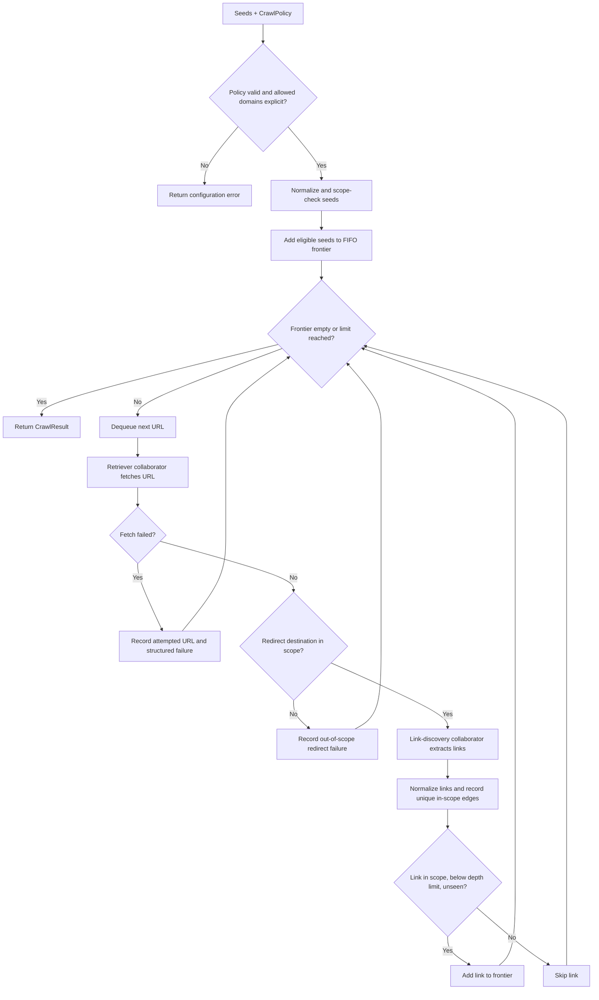

# Crawler Roadmap

This document tracks implementation work for the Crawler module. It is an
actionable plan, not a commitment to dates. Mark work complete only after the
implementation, documentation, and validation are present.

## Direction

Build a reusable crawler in stages:

1. Implement a deterministic, framework-independent traversal core.
2. Add optional Scrapy HTTP retrieval once the core contract is stable.
3. Add optional Playwright rendering only when JavaScript-rendered pages are
   an established use case.

The core coordinates what to visit and when to stop. It receives retrieval
and link-discovery collaborators through narrow contracts. Keep it independent
of Scrapy, Playwright, the Fetcher module, the HTML Parser module, network
access, and durable storage. Do not duplicate a framework adapter's scheduler
with a second frontier.

## Phase 1: Framework-independent core

### Public contract

- [x] Define and export `CrawlPolicy`, `Crawler`, `CrawlResult`, and a
  structured per-URL failure type.
- [x] Require explicit `allowed_domains` and finite page, depth, and elapsed
  time limits.
- [x] Define narrow, typed retrieval and link-discovery collaborator
  contracts. Keep network and HTML interpretation outside the core.
- [x] Return traversal metadata only: visited/successful URLs, structured
  failed URLs, discovered URLs, and unique directed link edges.
- [x] Document result semantics: failed URLs are also visited/attempted URLs;
  discovered URLs are unique in-scope links found on pages and exclude seeds;
  edges are unique directed source-to-target links.
- [x] Document that the elapsed-time limit prevents starting additional work
  but cannot interrupt a blocking collaborator. Retrievers must enforce
  request timeouts.

### URL identity and scope

- [x] Resolve relative links against the source page URL.
- [x] Accept only HTTP(S) URLs.
- [x] Normalize scheme and host casing; remove default ports and fragments;
  preserve query strings, paths, and trailing slashes.
- [x] Enforce exact allowed-host matching. A subdomain is in scope only when
  it is explicitly listed.
- [x] Apply the same normalization and scope checks to seeds, discovered
  links, duplicate tracking, and redirect destinations reported by a
  retriever.
- [x] Add deterministic tests for every normalization, resolution, and scope
  rule before treating URL identity as stable.

### Traversal and limits

- [x] Implement an in-memory FIFO frontier with stable scheduling order.
- [x] Track scheduled, attempted, successful, and failed URLs separately to
  avoid duplicate work and make result semantics consistent.
- [x] Enforce page, depth, and elapsed-time bounds before starting additional
  work.
- [x] Record unique directed link edges and structured failures without
  storing response bodies or extracted page data.
- [x] Keep retries, throttling, robots.txt fetching, persistence, distributed
  workers, and network access out of the core.

### Tests, docs, and acceptance

- [x] Cover URL resolution/normalization, query preservation, fragments,
  default ports, trailing slash identity, and duplicate handling.
- [x] Cover explicit scope checks for seeds, links, and reported redirects,
  including disallowed schemes and subdomains.
- [x] Cover FIFO order, depth/page/time stopping, failures, edge counting,
  and result semantics.
- [x] Use deterministic fakes, fixtures, or controlled local servers; never
  rely on public websites.
- [x] Export the supported public API and align the module README, manifest,
  crawler skill, and examples with the implementation.
- [x] Add no runtime dependencies for this phase.
- [x] Run the focused crawler tests from `modules/crawler/`:
  `python -m pytest`.

## Phase 2: Optional Scrapy HTTP adapter

The adapter is a Scrapy-native spider with a Python helper entry point. It
shares the core policy and URL identity rules while leaving request scheduling
and duplicate filtering to Scrapy.

- [x] Add Scrapy as an optional dependency so core users do not need to
  install it.
- [x] Compose the adapter with the core's traversal contract; use Scrapy's
  scheduler rather than adding a competing queue/deduplication scheduler.
- [x] Enforce robots.txt compliance, request timeouts, bounded retries, and
  throttling in the adapter.
- [x] Keep redirect destinations subject to the same explicit scope policy.
- [x] Preserve structured URL failures and expose adapter errors explicitly.
- [x] Test robots policy, redirects, failures, and bounded request behavior
  with controlled fixtures or local servers.
- [x] Document optional installation, configuration, permissions, and
  behavior; update package metadata, manifest, skill, and examples.

## Phase 3: Optional Playwright rendering

- [x] Add Playwright only as an optional integration dependency.
- [x] Keep ordinary HTTP as the default; make browser rendering opt-in for
  crawl page requests rather than enabling it for every crawl.
- [x] Document browser installation, resource limits, and configuration.
- [x] Test against a controlled local JavaScript fixture and verify ordinary
  Scrapy requests remain unaffected.
- [x] Update the module README, manifest, skill, and examples to match the
  supported behavior.

## Core traversal flow

